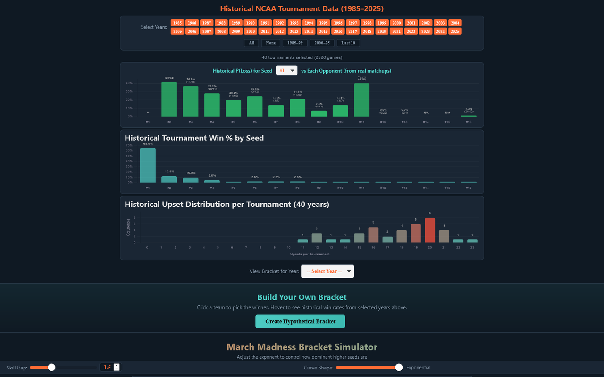
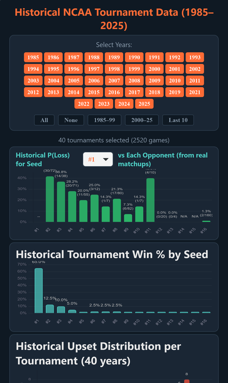
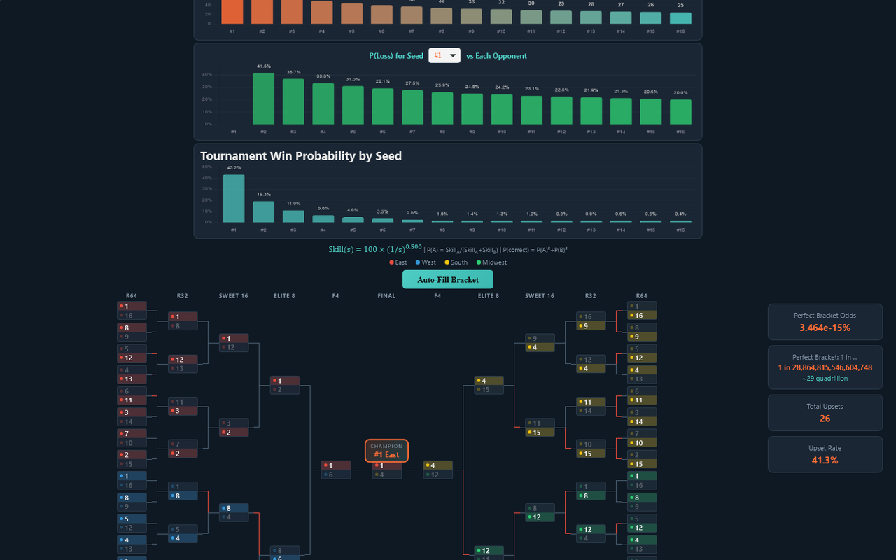

# March Madness Bracket Simulator

Explore how every NCAA tournament seed has actually done since 1985, then build your own bracket or let a tunable model fill one in for you.

**[▶ Open the live app](https://timothyhadfield.github.io/march-madness/)** · works on phone and laptop

  
  &nbsp;
  

  

## Features
- **40 years of real results** — every men's tournament from 1985 to 2025 (no 2020); pick any mix of years or use presets like "Last 10".
- **Seed-vs-seed history** — how often a seed lost to each opponent seed, with the actual win-loss counts.
- **Title odds and upset counts** — championship % by seed and how many upsets each tournament had.
- **Any past bracket** — pick a year to see the full real bracket.
- **Build your own bracket** — click teams to pick winners; hover to see historical win rates for that matchup.
- **Tunable simulator** — a skill-gap slider and curve shape set how dominant top seeds are, and the charts, odds and upset forecast update live.
- **Auto-fill** — simulates a whole 63-game bracket and shows its upset count and the odds of a perfect bracket (think 1 in 29 quadrillion).

## Built with
A single HTML page with plain JavaScript and Chart.js, plus a JSON file of seed results.
